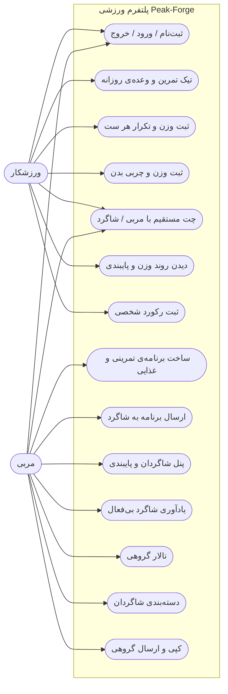
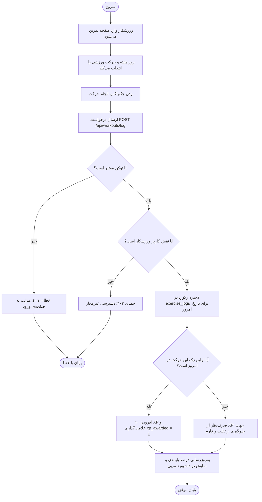
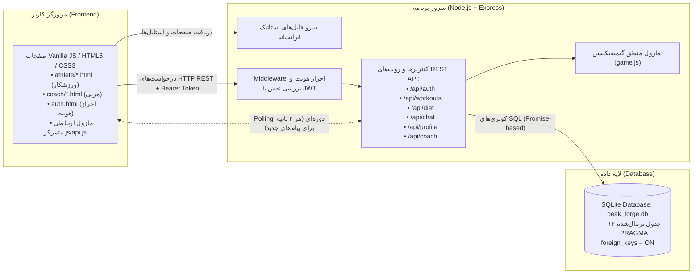
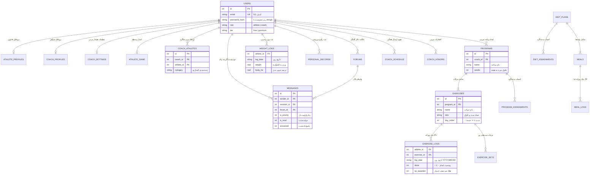

# Peak-Forge — مستندات جامع ارائه فاز اول (Analysis & Design Review)
> **درس مهندسی نرم‌افزار (تحلیل و طراحی سیستم‌ها) — نیم‌سال اول ۱۴۰۵**  
> **ارائه‌ی فاز اول (Presentation 1):** بررسی تحلیل، طراحی و معماری MVP  
> **مهلت تحویل:** ۲۴ آبان ساعت ۲۳:۵۹ | **مدت ارائه:** ۸ دقیقه ارائه + ۴ دقیقه پرسش و پاسخ | **بارم:** ۲۰ نمره

---

## فهرست مطالب
1. [معرفی محصول و مسئله (Problem & MVP Definition)](#۱-معرفی-محصول-و-مسئله)
2. [مرزهای MVP و موارد خارج از محدوده (Scope & Out-of-Scope)](#۲-مرزهای-mvp-و-موارد-خارج-از-محدوده)
3. [داستان‌های کاربری و معیارهای پذیرش (User Stories & Acceptance Criteria)](#۳-داستانهای-کاربری-و-معیارهای-پذیرش)
4. [نماهای چهارگانه طراحی (Four Required Design Views)](#۴-نماهای-چهارگانه-طراحی)
   - [۱) نمودار UML Use Case](#۱-نمودار-uml-use-case)
   - [۲) نمودار UML Activity (جریان تیک تمرین با مسیرهای خطا)](#۲-نمودار-uml-activity)
   - [۳) نمودار معماری سیستم (System Architecture)](#۳-نمودار-معماری-سیستم)
   - [۴) نمودار مدل داده (ERD & Constraints)](#۴-نمودار-مدل-داده-erd)
5. [پروتوتایپ کلیک‌شدنی (Clickable Prototype)](#۵-پروتوتایپ-کلیکشدنی)
6. [قرارداد API (API Contract Summary)](#۶-قرارداد-api)
7. [توجیه معماری، تکنولوژی و هاستینگ (Tech Stack & Hosting Rationale)](#۷-توجیه-معماری-تکنولوژی-و-هاستینگ)
8. [سهم و مسئولیت اعضای تیم (Team Responsibilities)](#۸-سهم-و-مسئولیت-اعضای-تیم)
9. [راهنمای اجرای محلی و تست‌ها (Running & Verification)](#۹-راهنمای-اجرای-محلی-و-تستها)

---

## ۱. معرفی محصول و مسئله
**Peak-Forge** یک پلتفرم وب دوطرفه برای اتصال **ورزشکاران** و **مربیان بدنسازی و تناسب اندام** است.

### صورت مسئله:
ورزشکاران و مربیان در حال حاضر با چالش‌های زیر روبرو هستند:
1. **پراکندگی اطلاعات:** برنامه‌های تمرینی و غذایی معمولاً در قالب فایل‌های PDF، تصاویر یا پیام‌های متنی در شبکه‌های اجتماعی (تلگرام، واتساپ) ارسال می‌شوند و ردیابی اجرای آن‌ها ناممکن است.
2. **نبود بازخورد بلادرنگ پایبندی:** مربیان دیدی نسبت به اینکه آیا شاگرد در روز مشخص تمرین کرده یا رژیم را رعایت کرده ندارند.
3. **تداخل ارتباط کاری و شخصی:** چت‌های آموزشی و اصلاح حرکات با پیام‌های روزمره مخلوط شده و پیام‌های فوری بی‌پاسخ می‌مانند.

### راه‌حل MVP:
پلتفرم متمرکز وب با احراز هویت نقش‌محور، ایجاد و انتساب مستقیم برنامه‌های تمرینی/غذایی، سیستم تیک‌زدن روزانه توسط شاگرد، محاسبه خودکار درصد پایبندی برای مربی، و سیستم چت مستقیم و تالارهای گروهی اختصاصی.

---

## ۲. مرزهای MVP و موارد خارج از محدوده
جهت تحویل سریع و اعتبارسنجی فرضیات هسته تجاری (Business Journey):

### قابلیت‌های داخل محدوده (In-Scope MVP):
- احراز هویت امن با توکن JWT و تفکیک نقش (ورزشکار / مربی) و سطح اشتراک (رایگان / پرمیوم).
- ایجاد برنامه‌های تمرینی و غذایی همراه با جزئیات حرکات، ست‌ها، زمان استراحت و وعده‌ها.
- انتساب برنامه توسط مربی به ورزشکاران با برقراری خودکار رابطه مربی–شاگرد.
- تیک روزانه حرکات و وعده‌ها توسط ورزشکار با محاسبه زنده پایبندی هفتگی.
- گفت‌وگوی متنی دوطرفه، تالارهای گروهی برای هر مربی، و صندوق پیام‌های اولویت‌دار.
- ثبت شاخص‌های پیشرفت بدنی (وزن، درصد چربی و رکوردهای شخصی).

### موارد عمداً خارج از محدوده (Out-of-Scope):
- **درگاه بانکی واقعی:** پرداخت با درگاه شاپرک/بین‌المللی حذف شده و به‌صورت شبیه‌سازی درون‌برنامه‌ای پیاده‌سازی شده است.
- **اپلیکیشن Native موبایل:** با طراحی فرانت‌اند Responsive و شبیه وب‌اپلیکیشن برطرف شده است.
- **تماس تصویری/صوتی زنده:** ارتباط به پیام متنی و اعلان متمرکز شده است.
- **پردازش تصویر با هوش مصنوعی برای اصلاح فرم حرکت:** جزو برنامه‌های آتی نسخه ۳ است.

---

## ۳. داستان‌های کاربری و معیارهای پذیرش

داستان‌های کاربری با فرمت استاندارد:  
`به‌عنوان [نقش کاربر]، می‌خواهم [قابلیت/اقدام]، تا اینکه [ارزش/سود حاصله].`

### الف) اولویت حیاتی (Must Have)
| شناسه | داستان کاربر | معیارهای پذیرش کلیدی (Acceptance Criteria) |
|---|---|---|
| **US-01** | به‌عنوان کاربر، می‌خواهم ثبت‌نام و ورود امن با رمز عبور داشته باشم تا داده‌هایم حفظ شود. | • توکن JWT با انقضای ۷ روز صادر می‌شود.<br>• رمز در دیتابیس با bcrypt هش می‌شود.<br>• ایمیل تکراری با خطای `409` و رمز اشتباه با `401` رد می‌شود. |
| **US-02** | به‌عنوان کاربر، می‌خواهم بتوانم از حساب خارج شوم تا امنیت اطلاعات روی دستگاه مشترک تأمین شود. | • توکن و شناسنامه از localStorage پاک شده و کاربر به صفحه‌ی ورود هدایت می‌شود.<br>• درخواست‌های بعدی با توکن حذف‌شده `401` دریافت می‌کنند. |
| **US-03** | به‌عنوان مربی، می‌خواهم برنامه‌ی تمرینی با حرکات مشخص بسازم تا به شاگردانم بدهم. | • ایجاد برنامه با نام و طول دوره (هفته) ذخیره و ماندگار است.<br>• افزودن حرکت بدون نام رد می‌شود (`400`).<br>• مربی فقط برنامه‌های خودش را می‌تواند ویرایش/حذف کند. |
| **US-04** | به‌عنوان مربی، می‌خواهم برنامه‌ی غذایی با وعده‌ها بسازم تا رژیم شاگرد تعیین شود. | • ثبت وعده شامل نام، زمان، مواد و کالری اختیاری است.<br>• داده در دیتابیس ماندگار است. |
| **US-05** | به‌عنوان مربی، می‌خواهم برنامه را به شاگرد منتسب کنم تا در کارتابل او قرار گیرد. | • انتساب، رابطه مربی-شاگرد را در `coach_athletes` برقرار می‌کند.<br>• ارسال مجدد، رکورد تکراری نمی‌سازد (قید `UNIQUE`). |
| **US-06** | به‌عنوان ورزشکار، می‌خواهم حرکات امروز را تیک بزنم تا پایبندی من ثبت شود. | • تیک تمرین ثبت و ماندگار است.<br>• ورزشکار A نمی‌تواند لاگ ورزشکار B را دستکاری کند (استخراج شناسه از توکن). |
| **US-07** | به‌عنوان ورزشکار، می‌خواهم وعده‌های غذایی امروز را تیک بزنم تا اجرای رژیم مشخص شود. | • مشابه US-06، محاسبه درصد تحقق وعده‌ها و ذخیره در لاگ روزانه. |
| **US-08** | به‌عنوان عضو (مربی/ورزشکار)، می‌خواهم گفت‌وگوی مستقیم با طرف مقابل داشته باشم. | • ارسال پیام متنی با polling دوره‌ای.<br>• پیام به کاربر غیرمرتبط مسدود می‌شود (`403`).<br>• وضعیت خوانده‌نشده محاسبه می‌شود. |
| **US-09** | به‌عنوان مربی، می‌خواهم فهرست شاگردانم را با درصد پایبندی و روزهای بی‌فعالیتی ببینم. | • پایبندی = تیک‌های ۷ روز اخیر ÷ تعداد موارد مقرر در برنامه.<br>• هشدار عدم ثبت تمرین برای روزهای غیبت نمایش داده می‌شود. |
| **US-10** | به‌عنوان ورزشکار، می‌خواهم وزن روزانه‌ام را ثبت کنم تا نمودار تغییرات را ببینم. | • روزانه حداکثر یک رکورد با Upsert ذخیره می‌شود.<br>• مقادیر منفی یا غیرمنطقی رد می‌شوند (`400`). |

### ب) اولویت مهم (Should Have)
- **US-11 (پیام اولویت‌دار):** ارسال پیام فوری با علامت ★ و صندوق پاسخ اختصاصی مربی.
- **US-12 (ارتقای پلن درون‌برنامه‌ای):** شبیه‌سازی خرید اشتراک Premium و باز شدن قفل‌ها سمت کلاینت و سرور.
- **US-13 (کپی و ارسال گروهی برنامه):** کپی کردن الگوهای تمرینی و ارسال یک‌کلیکه به شاگردان یک دسته.
- **US-14 (ثبت جزئیات ست‌ها):** ثبت وزن و تعداد تکرار هر ست در روز تمرین.
- **US-15 (گیمیفیکیشن):** اعطای XP بر اساس فعالیت روزانه، رتبه، سطح و نشان‌ها همراه با قید ضد-فارم (`xp_awarded`).

### ج) اولویت اختیاری (Could Have)
- **US-16 (تالارهای گفت‌وگوی گروهی):** اتاق گفت‌وگوی مربی با تمام شاگردان زیرمجموعه‌اش.
- **US-17 (دسته‌بندی شاگردان):** تگ‌گذاری شاگردان (حجم، کاهش وزن، مبتدی) و فیلتر کردن آن‌ها.
- **US-18 (یادآوری خودکار و دستی):** ارسال پیام یادآوری مستقیم به چت شاگرد بی‌فعال.
- **US-19 (تقویم هفتگی ارسال برنامه):** زمان‌بندی هفتگی ارسال الگوها به شاگردان.
- **US-20 (بازیابی رمز عبور):** تولید کد یک‌بارمصرف ۱۰ دقیقه‌ای و تغییر امن کلمه عبور.
- **US-21 (گزارش عملکرد چاپی):** مشاهده خلاصه کارکرد دوره‌ای و دریافت خروجی PDF با Print مرورگر.

---

## ۴. نماهای چهارگانه طراحی

### ۱) نمودار UML Use Case
تعریف بازیگران سیستم و کلیه تعاملات مجاز در محدوده MVP:



---

### ۲) نمودار UML Activity
جریان کاری کلیدی «تیک زدن تمرین روزانه» همراه با تمام شروط، تصمیم‌ها و مسیرهای شکست (خطاهای ۴۰۱ و ۴۰۳ و اعطای امن XP):



---

### ۳) نمودار معماری سیستم
لایه‌بندی نرم‌افزار، مسئولیت هر بخش و پروتکل‌های ارتباطی:



---

### ۴) نمودار مدل داده (ERD)
موجودیت‌های ماندگار، فیلدهای کلیدی، کلیدهای اصلی (`PK`)، خارجی (`FK`) و محدودیت‌های یکپارچگی داده:



#### محدودیت‌های کلیدی دیتابیس (Constraints):
- **یکتایی لاگ تمرین روزانه:** `UNIQUE(athlete_id, exercise_id, log_date)` در جدول `exercise_logs` مانع از ثبت دوباره یک حرکت در یک روز می‌شود.
- **یکتایی لاگ وزن روزانه:** `UNIQUE(athlete_id, log_date)` مانع از تکرار چندباره وزن در یک روز می‌شود.
- **یکتایی ارتباط شاگرد-مربی:** `UNIQUE(coach_id, athlete_id)` در جدول `coach_athletes`.
- **فعال‌سازی کلید خارجی:** اجرای `PRAGMA foreign_keys = ON` در بدو اتصال دیتابیس جهت اعمال خودکار `ON DELETE CASCADE` (حذف حرکات با حذف برنامه و جلوگیری از Orphan Rows).

---

## ۵. پروتوتایپ و برد طراحی Figma

برای مرور بصری جریان‌ها، یک برد SVG در [docs/figma-board.svg](docs/figma-board.svg) قرار دارد. برد، چهار فریم موبایل RTL را نشان می‌دهد: ورود با حالت خطا، تمرین ورزشکار با حالت موفق/خطا، صندوق پیام اولویت‌دار مربی و پنل پایبندی شاگردان.

- **واردکردن به Figma:** فایل SVG را روی Canvas بکشید یا از `File → Place image` استفاده کنید. پس از واردکردن، در صورت نیاز فریم‌ها را Ungroup کنید و اتصال‌های Prototype را داخل Figma بسازید.
- **محدودیت:** این SVG یک برد طراحی قابل‌واردکردن است، نه فایل بومی `.fig` و نه پروتوتایپ تعاملی Figma. برای بررسی جریان تعاملی، نسخه‌ی HTML در [docs/prototype.html](docs/prototype.html) در دسترس است و با `http://localhost:3000/docs/prototype.html` اجرا می‌شود.
- **سناریوهای برد:** ورود موفق/ناموفق، تیک تمرین و تغییر درصد، پیام اولویت‌دار و پاسخ مربی، و مرور پایبندی شاگردان.

---

## ۶. قرارداد API
خلاصه قرارداد ارتباط فرانت‌اند و بک‌اند (کل ۵۵ روت در [docs/api.md](docs/api.md) مستند شده‌اند):

| ماژول | متد و مسیر | ورودی‌ها | خروجی موفق | خطاهای پیش‌بینی‌شده |
|---|---|---|---|---|
| **Auth** | `POST /api/auth/signup` | email, password, role, first, last, ... | `201` + token + user | `400` فیلد ناقص، `409` ایمیل تکراری |
| **Auth** | `POST /api/auth/login` | email, password | `200` + token + user | `401` رمز یا ایمیل نادرست |
| **Workouts** | `GET /api/workouts/programs` | Header: Bearer Token | `200` لیست برنامه‌های مرتبط | `401` عدم احراز هویت |
| **Workouts** | `POST /api/workouts/programs` | name, type, weeks | `201` شیء برنامه ایجادشده | `400` نام نامعتبر، `403` عدم دسترسی نقش |
| **Workouts** | `POST /api/workouts/programs/:id/assign` | athlete_id | `200` پیام موفقیت انتساب | `400` داده ناقص، `404` برنامه ناموجود |
| **Workouts** | `POST /api/workouts/log` | exercise_id, done | `200` وضعیت لاگ + XP روزانه | `401` توکن، `403` برای مربی |
| **Diet** | `GET /api/diet/plans` | Header: Bearer Token | `200` لیست برنامه‌های غذایی | `401` عدم احراز هویت |
| **Chat** | `POST /api/chat/messages` | receiver_id, text, is_priority | `201` شیء پیام ارسالی | `400` متن خالی، `403` کاربر غیرمتصل |
| **Chat** | `GET /api/chat/messages/:peerId` | پارامتر شناسه طرف مقابل | `200` تاریخچه پیام‌ها + تیک خوانده‌شدن | `403` نبود ارتباط مربی-شاگرد |
| **Coach** | `GET /api/coach/athletes` | Header: Bearer Token | `200` لیست شاگردان + پایبندی و غیبت | `403` برای نقش غیرمربی |
| **Coach** | `POST /api/coach/athletes` | email | `200` اتصال شاگرد جدید | `403` سقف ۵ شاگرد در پلن رایگان، `404` ایمیل ناموجود |

---

## ۷. توجیه معماری، تکنولوژی و هاستینگ

### لایه‌بندی و انتخاب فناوری‌ها:
1. **فرانت‌اند (Vanilla HTML5 / CSS3 / JavaScript):**
   - *چرایی:* به حداقل رساندن Overhead بیلد و ابزارهای کامپایل پیچیده (مانند Webpack/Vite)؛ یادگیری و دفاع فنی ساده و شفاف‌تر؛ اجرای مستقیم و سریع در مرورگر؛ صفحات مستقل و پایدار.
   - *نقاط مصالحه (Trade-offs):* مدیریت دستی DOM به‌جای Virtual DOM و عدم استفاده از کلاینت‌ساید روتینگ فریم‌ورک‌ها که با معماری صفحات متمرکز حل شده است.
2. **بک‌اند (Node.js + Express):**
   - *چرایی:* زبان یکپارچه (JavaScript) در کل پروژه؛ ماژولار بودن بالای Express برای تقسیم روت‌ها و پیاده‌سازی تمیز Middlewareهای احراز هویت (`auth.js`) و قوانین کسب‌وکار.
3. **دیتابیس (SQLite - فایل `peak_forge.db`):**
   - *چرایی:* نیاز ذاتی مدل کسب‌وکار به ارتباطات رابطه‌ای قوی (شاگرد به مربی، برنامه به حرکات، لاگ‌ها به تاریخ و تمرین) و تضمین یکپارچگی با قیدهای کلید خارجی و یکتایی. عدم نیاز به سرور مجزای پایگاه داده و سهولت پشتیبان‌گیری.
   - *نقاط مصالحه:* مناسب بودن برای مقیاس‌های MVP و همزمانی‌های متوسط؛ برای مقیاس فوق‌سنگین در نسخه‌های تجاری با PostgreSQL جایگزین خواهد شد.
4. **احراز هویت (JWT + bcryptjs):**
   - *چرایی:* سشن بدون حالت (Stateless)، مقیاس‌پذیری ساده و امکان حمل نقش (`role`) و سطح دسترسی (`tier`) درون Payload توکن.

### طرح هاستینگ و استقرار (Hosting Rationale):
- **بستر منتخب: Railway**
  - دارای پشتیبانی از **Persistent Volume** جهت حفظ دائم دیسک دیتابیس SQLite (برخلاف پلن رایگان Render که دیسک موقت (Ephemeral) دارد و با هر خاموشی اطلاعات ریست می‌شود و الزامات درس را نقض می‌کند).
  - هزینه: حدود ۵ دلار ماهانه (تحت سهمیه رایگان اولیه یا شارژ ماهانه)، همراه با دامنه HTTPS آماده و اتصال خودکار به ریپوزیتوری گیت‌هاب.
- **پیکربندی محیط اجرا (Runtime Config):** خواندن `PORT`، مسیر دیتابیس و کلید امضای رمزنگاری `JWT_SECRET` از متغیرهای محیطی (`process.env`).

---

## ۸. سهم و مسئولیت اعضای تیم
بر اساس مستندات پروژه و شرح وظایف استاندارد مهندسی:

| عضو تیم | حوزه مسئولیت اصلی | مشارکت‌های فنی |
|---|---|---|
| **مهدی نظری** | هدایت فول‌استک، معماری بک‌اند و پایگاه‌داده | • طراحی معماری سیستم و پایگاه‌داده نرمال‌شده SQLite.<br>• پیاده‌سازی کامل هسته بک‌اند (REST API)، احراز هویت JWT و سیستم اعطای XP ضد تقلب.<br>• تست‌های خودکار یکپارچه‌سازی و پیاده‌سازی صفحات یکپارچه و منطق اشتراک (Tier-Aware). |
| **اعضای همکار تیم** | تحلیل نیازمندی‌ها، طراحی اولیه UI و مستندات | • استخراج داستان‌های کاربری اولیه و ماتریس اولویت‌بندی MoSCoW.<br>• تدوین سناریوهای کاربری و بررسی نیازمندی‌های فازبندی MVP. |

---

## ۹. راهنمای اجرای محلی و تست‌ها

### پیش‌نیازها:
- Node.js نسخه‌ی ۱۸ یا بالاتر

### راه‌اندازی سریع:
```bash
# ۱. رفتن به پوشه بک‌اند و نصب وابستگی‌ها
cd backend
npm install

# ۲. اجرای سرور توسعه
npm start
```
سرور و فرانت‌اند به‌صورت هم‌زمان روی پورت ۳۰۰۰ اجرا می‌شوند:  
🌐 آدرس برنامه در مرورگر: **`http://localhost:3000/auth.html`**

### حساب‌های آزمایشی آماده (رمز همگی: `123456`):
- **مربی پرمیوم:** `smoke.coach@pf.ir`
- **ورزشکار پرمیوم:** `smoke.ath@pf.ir`
- **ورزشکار رایگان:** `negar.smoke@pf.ir`

### اجرای تست‌های خودکار بک‌اند:
```bash
cd backend
node test-chat.js    # ۲۳ تست خودکار چت، تالارها و کنترل دسترسی
node test-coach.js   # ۲۴ تست خودکار انتساب، فرمول پایبندی و سقف رایگان
```
*هر ۴۷ تست با نتیجه‌ی `PASS` تأیید شده‌اند.*
