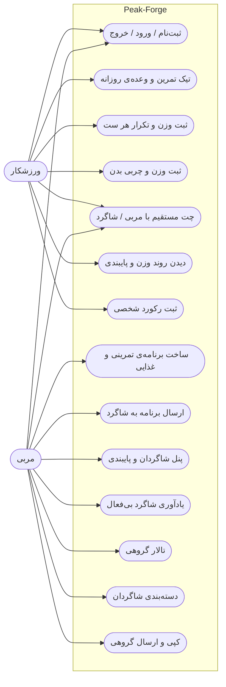
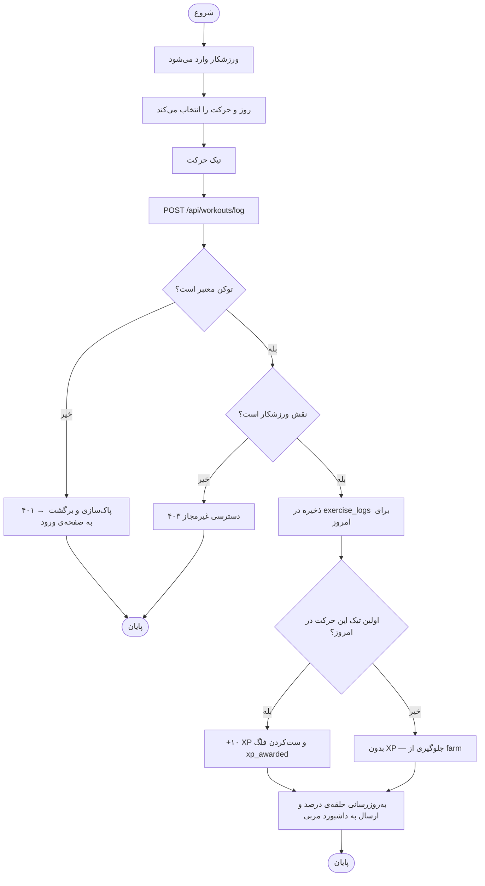
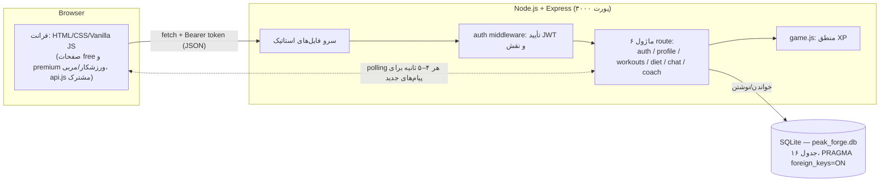
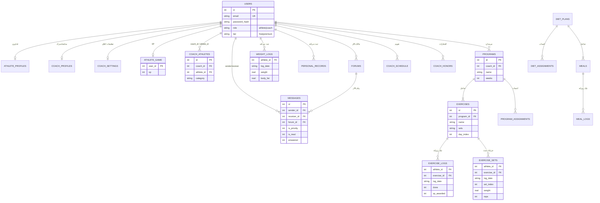

# Design Views — Peak-Forge

چهار نمای طراحی الزامی سند پروژه + توجیه فنی. نمودارها Mermaid هستند و در
GitHub مستقیماً رندر می‌شوند.

## ۱) UML Use Case — بازیگران و کارها

## ۲) UML Activity — جریان «تیک زدن تمرین» با مسیرهای خطا

## ۳) System Architecture

انتخاب‌ها و چرایی:

- **Vanilla JS بدون فریم‌ورک فرانت:** پروژه‌ی ترمی با حجم UI محدود؛ بدون بیلد
  و وابستگی، یادگیری و دفاع آسان‌تر. trade-off: رندر دستی DOM و بدون routing.
- **Express:** سبک و شفاف؛ لایه‌بندی «route → قاعده‌ی کسب‌وکار → دسترسی داده»
  قابل توضیح است. اعتبارسنجی ورودی داخل روت‌ها، احراز هویت در middleware.
- **SQLite (فایل):** رابطه‌ای است چون موجودیت‌ها به هم وابسته‌اند (کاربر → برنامه →
  حرکت → لاگ)؛ با UNIQUE constraint ها یکپارچگی تضمین می‌شود (مثلاً یک لاگ در روز).
  trade-off: برای دیپلوی به دیسک پایدار نیاز دارد و هم‌زمانی نویسنده محدود است —
  برای مقیاس MVP کافی است.
- **JWT:** stateless و ساده؛ trade-off: ابطال فوری توکن ممکن نیست (انقضای ۷ روز).

## ۴) ERD — مدل داده

محدودیت‌های کلیدی داده:

- `exercise_logs`: UNIQUE(athlete_id, exercise_id, log_date) — هر حرکت در روز
  فقط یک لاگ؛ مالکیت لاگ همیشه از توکن می‌آید نه ورودی کاربر.
- `exercise_sets`: UNIQUE(athlete_id, exercise_id, log_date, set_index).
- `coach_athletes`: UNIQUE(coach_id, athlete_id) — لینک تکراری ممکن نیست.
- `messages`: CHECK که یا گیرنده داشته باشد یا تالار.

## ۵) توجیه هاست و هزینه

- الزام: SQLite فایل است، پس هاست باید **دیسک پایدار** داشته باشد وگرنه داده
  با هر دیپلوی/ری‌استارت پاک می‌شود.
- **انتخاب پیشنهادی: Railway** با volume — حدود ۵ دلار در ماه، HTTPS و
  زیردامنه‌ی آماده می‌دهد، `npm start` بدون تغییر کد اجرا می‌شود و دیسک
  ماندگار است. محدودیت: سهمیه‌ی اجرا/حافظه‌ی پلن و هزینه‌ی اندک.
- گزینه‌ی رد‌شده: پلن رایگان Render — دیسک غیرماندگار است و داده بعد از
  ری‌استارت پاک می‌شود (نقض «ماندگاری داده» در سند).
- گزینه‌ی صفر-هزینه برای دمو: تونل HTTPS موقت (cloudflared) روی سیستم خود
  دانشجو — مناسب دموی زنده، نه انتشار دائمی.
- پیکربندی runtime: `PORT` و `JWT_SECRET` از متغیر محیطی خوانده می‌شوند
  (در کد `process.env` پشتیبانی شده)، دیتابیس در volume نصب می‌شود.
